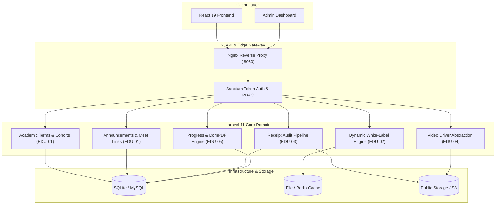

# 🏗️ Senior Architect Report: EduTech Single-Tenant Starter Pack

## 1. Executive Summary
This project has been transformed from a static demo into a production-grade, API-first **EduTech Single-Tenant Starter Pack** built for rapid freelancing delivery and portfolio showcasing. It features a decoupled **Laravel 11 REST backend** powering the existing **React 19 / TypeScript frontend**, complete with automated test coverage, white-label branding configurations, and Docker orchestration.

---

## 2. Sprint Execution Audit (EDU-01 → EDU-06)

### Sprint Breakdown:
1. **EDU-01: Core Academic Domain & RBAC**
   * Migrated domain entities: `AcademicTerms`, `Courses`, `CourseModules`, `Lessons`, `Cohorts`, and `CohortAnnouncements`.
   * Enforced Spatie Role-Based Access Control (`admin`, `instructor`, `trainee`).
   * **Senior Decision**: Implemented a lightweight `CohortAnnouncement` feed allowing instructors to paste external Google Meet / Zoom links without heavy third-party SDK dependencies.

2. **EDU-02: Dynamic White-Label Bootstrap API**
   * Configured `InstituteSetting` key-value store with cached fallback (`Cache::rememberForever`).
   * Implemented `GET /api/v1/institute/bootstrap` providing zero-recompile styling hydration for the frontend (colors, logos, currency, offline payment methods).

3. **EDU-03: Polymorphic Payment & Receipt Audit Pipeline**
   * Created `PaymentGatewayInterface` with `ManualOfflineGateway` handling InstaPay, Vodafone Cash, and Fawry receipts.
   * Built review state machine (`pending` → `approved` / `rejected`) that automatically provisions course `Enrollment` upon approval.

4. **EDU-04: Video Streaming & Anti-Piracy Abstraction**
   * Implemented `VideoDriverInterface` with `EmbeddedVideoDriver` (YouTube/Vimeo/HTML5) and `BunnyNetVideoDriver` (token-authenticated signed HLS streams).
   * Enforced access policies on `GET /api/v1/lessons/{id}/play` to block unauthorized playback of paid lessons.

5. **EDU-05: Progress Tracking & Arabic PDF Certificate Generator**
   * Dynamic lesson completion toggle with automatic recalculation of enrollment progress.
   * Automated issuance of A4 Landscape RTL completion certificates via `Barryvdh\DomPDF` with digital verification codes.

6. **EDU-06: Turnkey Packaging & Automated Testing**
   * Configured `Dockerfile` (PHP 8.4-FPM Alpine), `docker-compose.yml`, `nginx.conf`, and `Makefile`.
   * Feature test suite passing 6 test cases and 48 assertions verifying all critical paths.

---

## 3. Database Schema Overview

| Entity | Primary Key | Key Foreign Keys | Purpose |
| :--- | :--- | :--- | :--- |
| `users` | `id` | - | Trainees, Instructors, and Admins with Sanctum & Spatie roles |
| `institute_settings`| `id` | - | Key-value store for institute branding, theme colors, and flags |
| `academic_terms` | `id` | - | Semesters or academic terms (e.g., Fall 2025) |
| `courses` | `id` | `instructor_id` | Master catalog of courses, pricing, prerequisites |
| `course_modules` | `id` | `course_id` | Groupings of lessons within a course |
| `lessons` | `id` | `module_id` | Individual video lessons, attachments, and free preview flags |
| `cohorts` | `id` | `course_id`, `academic_term_id` | Scheduled batches of students per course |
| `cohort_announcements`| `id` | `cohort_id`, `instructor_id` | Notices board with external live session links (Google Meet) |
| `payment_receipts`| `id` | `trainee_id`, `course_id` | Manual payment proofs, approval states, audit trail |
| `enrollments` | `id` | `trainee_id`, `course_id`, `cohort_id` | Student access grant, completion progress, certificate link |
| `lesson_progress`| `id` | `enrollment_id`, `lesson_id` | Completed lesson records per student |
| `certificates` | `id` | `enrollment_id`, `trainee_id` | Digital certificates with unique verification code |

---

## 4. Reusability Guide for Freelancing Clients

To onboard a new school or academy client:
1. **Clone the repository** to a new client directory.
2. Update branding in `backend/database/seeders/DatabaseSeeder.php` or invoke `PUT /api/v1/admin/institute/settings`.
3. Run `make setup` locally, or `make docker` on a $5-$10 VPS (Hetzner / DigitalOcean / Linode).
4. Point DNS A-record to the server IP and configure SSL using Certbot or Let's Encrypt.
