# 🛠️ Comprehensive Tech Stack Tutorial: EduTech Starter Pack

A complete technical tutorial and architectural deep-dive into the stack used to build this single-tenant EduTech platform: **Laravel 11**, **React 19 + TypeScript**, **Sanctum**, **Spatie Permission**, **Barryvdh DomPDF**, **Docker**, and **Nginx**.

---

## 1. Architectural Stack Overview

```mermaid
graph LR
    subgraph Frontend ["Frontend Layer"]
        React["React 19 + TypeScript"]
        Tailwind["Tailwind CSS (RTL)"]
        Vite["Vite Build Tool"]
    end

    subgraph API ["Transport & Security"]
        Nginx["Nginx Reverse Proxy"]
        Sanctum["Laravel Sanctum (Tokens)"]
        RBAC["Spatie Permission (Roles)"]
    end

    subgraph Backend ["Backend Core (Laravel 11)"]
        Bootstrap["Dynamic Institute Settings"]
        PaymentCore["Payment Driver Pattern"]
        VideoCore["Video Driver Pattern"]
        PDF["DomPDF Certificate Engine"]
    end

    subgraph Storage ["Data Layer"]
        SQLite["SQLite (Local/Dev) / MySQL"]
        StorageDisk["Public Disk / S3 Storage"]
    end

    Frontend --> Nginx
    Nginx --> Sanctum
    Sanctum --> RBAC
    RBAC --> Backend
    Backend --> Storage
```



---

## 2. Backend Architecture Deep-Dive (Laravel 11)

### A. API Scaffolding & Stateless Auth (Sanctum)
Laravel 11 ships with a minimalist skeleton. The API layer is activated via:
```bash
php artisan install:api
```
* **Authentication Trait**: Added `use HasApiTokens` to [User.php](file:///Users/morsistoredz/antigravity/أكاديمية-التعلم---منصة-التدريب-الإلكتروني/backend/app/Models/User.php).
* **Token Issuance**: When users authenticate via `POST /api/v1/auth/login`, Sanctum generates a plain-text cryptographic bearer token stored in `personal_access_tokens`.
* **Guard Registration**: All protected API endpoints use the `auth:sanctum` middleware in [routes/api.php](file:///Users/morsistoredz/antigravity/أكاديمية-التعلم---منصة-التدريب-الإلكتروني/backend/routes/api.php).

### B. Role-Based Access Control (Spatie Permission)
Configured 3 distinct roles: `admin`, `instructor`, and `trainee`:
* **User Integration**: `use HasRoles` added to the `User` model.
* **Laravel 11 Middleware Alias**: Registered aliases inside [bootstrap/app.php](file:///Users/morsistoredz/antigravity/أكاديمية-التعلم---منصة-التدريب-الإلكتروني/backend/bootstrap/app.php):
  ```php
  $middleware->alias([
      'role' => \Spatie\Permission\Middleware\RoleMiddleware::class,
      'permission' => \Spatie\Permission\Middleware\PermissionMiddleware::class,
  ]);
  ```

---

## 3. Core Software Engineering Patterns Implemented

### Pattern 1: Dynamic White-Label Settings Engine (EDU-02)
Instead of hardcoding client branding in frontend environment variables, we use a cached database-backed settings store in [InstituteSetting.php](file:///Users/morsistoredz/antigravity/أكاديمية-التعلم---منصة-التدريب-الإلكتروني/backend/app/Models/InstituteSetting.php):
```php
public static function allCached(): array
{
    return Cache::rememberForever('institute_settings_all', function () {
        return static::pluck('value', 'key')->map(function ($val) {
            $decoded = json_decode($val, true);
            return json_last_error() === JSON_ERROR_NONE ? $decoded : $val;
        })->toArray();
    });
}
```
* **Benefit**: The React application calls `GET /api/v1/institute/bootstrap` at runtime to receive brand colors, logos, and localized payment accounts without recompiling assets.

---

### Pattern 2: Polymorphic Payment Gateway Pattern (EDU-03)
Manual offline transfers (InstaPay, Vodafone Cash, Fawry) are abstracted using the Strategy Pattern in [PaymentGatewayInterface.php](file:///Users/morsistoredz/antigravity/أكاديمية-التعلم---منصة-التدريب-الإلكتروني/backend/app/Services/Payments/PaymentGatewayInterface.php):
```php
interface PaymentGatewayInterface {
    public function identifier(): string;
    public function title(): string;
    public function requiresManualReview(): bool;
}
```
* **State Machine**: Receipts enter a `pending` state. When approved via [PaymentReceiptController.php](file:///Users/morsistoredz/antigravity/أكاديمية-التعلم---منصة-التدريب-الإلكتروني/backend/app/Http/Controllers/Api/PaymentReceiptController.php), an atomic DB transaction provisions the student's `Enrollment` record.

---

### Pattern 3: Video Driver Abstraction & Anti-Piracy (EDU-04)
Direct video URLs should never be exposed to unauthorized users. We built a driver factory in [VideoManager.php](file:///Users/morsistoredz/antigravity/أكاديمية-التعلم---منصة-التدريب-الإلكتروني/backend/app/Services/Video/VideoManager.php):
1. **EmbeddedVideoDriver**: Parses YouTube/Vimeo links and returns embed iframe codes.
2. **BunnyNetVideoDriver**: Generates SHA-256 token-signed URLs with a 4-hour expiration window:
   ```php
   $expires = time() + (4 * 3600);
   $token = hash('sha256', $apiKey . $videoId . $expires);
   ```
* **Policy Enforcement**: [LessonController.php](file:///Users/morsistoredz/antigravity/أكاديمية-التعلم---منصة-التدريب-الإلكتروني/backend/app/Http/Controllers/Api/LessonController.php) ensures only free preview lessons or students with active approved enrollments can fetch playback tokens.

---

### Pattern 4: Automatic Progress Recalculation & DomPDF (EDU-05)
1. When a student completes a lesson, `Enrollment::recalculateProgress()` counts completed lessons vs. total lessons in the course.
2. Upon reaching 100%, [CertificateService.php](file:///Users/morsistoredz/antigravity/أكاديمية-التعلم---منصة-التدريب-الإلكتروني/backend/app/Services/CertificateService.php) triggers:
   * Unique verification code creation: `CERT-2025-XXXXXX`.
   * High-resolution A4 landscape PDF rendering via `Barryvdh\DomPDF` and [template.blade.php](file:///Users/morsistoredz/antigravity/أكاديمية-التعلم---منصة-التدريب-الإلكتروني/backend/resources/views/certificates/template.blade.php).

---

## 4. Automated Testing & Verification

All core flows are tested using Laravel Feature Tests in [EduTechApiTest.php](file:///Users/morsistoredz/antigravity/أكاديمية-التعلم---منصة-التدريب-الإلكتروني/backend/tests/Feature/EduTechApiTest.php):
* `test_institute_bootstrap_returns_white_label_settings`
* `test_courses_catalog_returns_seeded_courses`
* `test_user_authentication_flow`
* `test_certificate_verification`
* `test_secure_lesson_playback_authorization` (verifies 401/403 guards on paid content)
* `test_receipt_review_approval_flow` (verifies automated enrollment creation)

To run tests:
```bash
make test
# Output: Tests: 8 passed (50 assertions)
```

---

## 5. Docker Packaging & Production Orchestration

The project includes an optimized multi-container setup in [docker-compose.yml](file:///Users/morsistoredz/antigravity/أكاديمية-التعلم---منصة-التدريب-الإلكتروني/docker-compose.yml):
* **Nginx Container**: Reverse proxies `/api` to PHP-FPM and serves `/storage` static files directly.
* **Backend Container**: Built from [Dockerfile](file:///Users/morsistoredz/antigravity/أكاديمية-التعلم---منصة-التدريب-الإلكتروني/backend/Dockerfile) using `php:8.4-fpm-alpine` with GD, BCMath, and SQLite/PDO extensions.
* **Frontend Container**: Node 20 Alpine running Vite.
* **Makefile**: Automates dev and deployment routines (`make setup`, `make dev`, `make docker`, `make test`).
