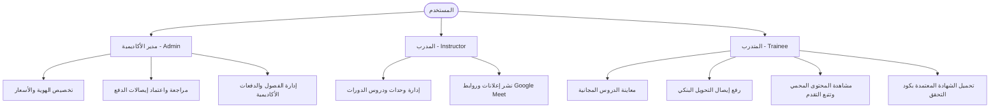

# 📖 دليل الاستخدام الشامل لمنصة الأكاديمية التعليمية (User Manual)

مرحباً بك في دليل الاستخدام والتشغيل الرسمي لمنصة **أكاديمية التعلم - EduTech Starter Pack**. تم تصميم هذا الدليل لتوجيه كافة مستخدمي المنصة (المديرين، المدربين، المتدربين، والمطورين المستقلين) لتشغيل واستخدام المنصة باحترافية.

---

## 👥 فهرس الأدوار وصلاحيات الوصول (Role Access Matrix)



---

## 1. دليل مدير الأكاديمية (Administrator Guide)

### أ. تسجيل الدخول
* البريد الافتراضي: `admin@academy.com`
* كلمة المرور: `password123`

### ب. تخصيص هوية الأكاديمية (White-Labeling)
لتعديل بيانات المعهد أو الأكاديمية (الاسم، الشعار، الألوان، طرق الدفع):
1. انتقل إلى لوحة الإعدادات أو أرسل طلباً عبر نقطة النهاية: `PUT /api/v1/admin/institute/settings`.
2. الحقول المتاحة للتخصيص:
   * **اسم المنصة**: `institute_name`
   * **اللون الأساسي**: `primary_color` (مثال: `#2563eb`)
   * **اللون المميز**: `accent_color` (مثال: `#f59e0b`)
   * **العملة**: رمز وكود العملة (`currency_code`, `currency_symbol`).
   * **حسابات التحويل المالي**: بيانات أرقام فودافون كاش وحساب إنستاباي.
> [!TIP]
> يتم تطبيق كافة التغييرات لحظياً على واجهة المتدربين دون الحاجة لإعادة بناء (Recompile) أو تعديل ملفات الواجهة الأمامية.

### ج. مسار مراجعة وتدقيق إيصالات الدفع (Payment Receipts Audit)
1. من القائمة الجانبية، اختر **"مراجعة الإيصالات"** (`/api/v1/admin/payments/receipts`).
2. تظهر قائمة بجميع الإيصالات بحالة `pending`.
3. انقر على الإيصال لمعاينة:
   * اسم ورقم هاتف المتدرب.
   * صورة إشعار التحويل البنكي / إنستاباي.
   * المبلغ المالي ورقم العملية المرجعي (`transaction_ref`).
4. **الاعتماد (Approve)**:
   * عند النقر على **اعتماد**، يقوم النظام تلقائياً بإنشاء قيد تسجيل (`Enrollment`) بحالة معتمدة وفتح جميع الدروس للمتدرب فوراً.
5. **الرفض (Reject)**:
   * عند الرفض، يلزم إدخال سبب الرفض (مثال: "المبلغ المحول غير مطابق لقيمة الدورة").

---

## 2. دليل المدرب (Instructor Guide)

### أ. تسجيل الدخول
* الحسابات التجريبية: `tarek@academy.com` أو `sara@academy.com` (كلمة المرور: `password123`).

### ب. إدارة الوحدات والدروس
1. افتح صفحة الدورة التدريبية.
2. لكل درس يمكنك تحديد:
   * **نوع الدرس**: معاينة مجانية (`is_free_preview`) أو درس مدفوع للمشتركين فقط.
   * **نوع مشغل الفيديو**:
     * `embedded`: رابط YouTube Unlisted أو Vimeo.
     * `bunny`: رابط بث مشفر ومحمي برمز وصول لحظي (Token-signed HLS).
   * **المرفقات**: رفع ملفات الـ PDF والأكواد البرمجية المرفقة بالدرس.

### ج. نشر إعلانات الدفعة وروابط اللقاءات الحية (Google Meet / Zoom)
1. ادخل إلى الدفعة التدريبية النشطة (`Cohort`).
2. اضغط على **"إعلان جديد"**.
3. أضف عنوان الإعلان، الوصف، وقم بلصق رابط الجلسة (مثال: `https://meet.google.com/xyz-abcd-123`).
4. حدد تاريخ ووقت الجلسة مع إمكانية تثبيت الإعلان في أعلى اللوحة.
> [!IMPORTANT]
> روابط الجلسات الحية تظهر فقط وحصرياً للمتدربين الذين تم اعتماد اشتراكهم وسداد رسوم الدفعة.

---

## 3. دليل المتدرب (Trainee Guide)

### أ. إنشاء حساب وتصفح الدورات
1. اضغط على **"تسجيل حساب جديد"** وأدخل الاسم، البريد، ورقم الهاتف.
2. تصفح كتالوج الدورات حسب المجال والمستوى.
3. يمكنك مشاهدة الدروس المميزة بعلامة **"معاينة مجانية"** فوراً دون دفع.

### ب. الاشتراك ورفع إيصال الدفع
1. في صفحة الدورة، اضغط على **"الاشتراك في الدورة"**.
2. اختر الدفعة الأكاديمية المناسبة.
3. تظهر لك بيانات التحويل المالي (InstaPay أو Vodafone Cash أو Fawry).
4. بعد إتمام التحويل من تطبيقك البنكي، قم برفع صورة الإشصال وإدخال رقم حساب التحويل.
5. تتغير حالة اشتراكك إلى "قيد المراجعة"، وستصلك رسالة تأكيد فور اعتماد الإدارة للطلب.

### ج. متابعة التعلم والدروس
1. انتقل إلى **"دوراتي التدريبية"** (`/api/v1/my-courses`).
2. شاهد الدروس المسجلة، وعند الانتهاء من كل درس انقر على **"تحديد كمكتمل"**.
3. يقوم النظام بتحديث مؤشر الإنجاز (Progress %) تلقائياً.

### د. إصدار وتحميل الشهادة المعتمدة
1. عند وصول نسبة الإنجاز إلى **100%**، يقوم النظام فورياً بإصدار شهادة معتمدة.
2. يظهر زر **"تحميل الشهادة (PDF)"**.
3. تحتوي الشهادة على كود رقمي فريد (مثال: `CERT-2025-ABCD12`) يمكن لأي جهة توظيف التحقق من صحته عبر الرابط:
   `GET /api/v1/certificates/{code}`

---

## 4. دليل التسليم للمستقلين (Freelancer Handover Guide)

عند تسليم هذا المشروع لعميل جديد كـ MVP:
1. **تشغيل المشروع محلياً أو على خادم العميل**:
   ```bash
   make setup
   make dev
   ```
2. **تشغيل الحاويات المجهزة للإنتاج (Production)**:
   ```bash
   make docker
   ```
3. **تغيير كلمات المرور الافتراضية**:
   قم بالدخول وتغيير كلمة مرور حساب المدير فوراً.
4. **تفعيل تخزين S3 (اختياري)**:
   في ملف `backend/.env`، قم بضبط إعدادات AWS أو Cloudflare R2 للصور ومقاطع الفيديو إذا رغب العميل في تخزين سحابي غير محلي.
